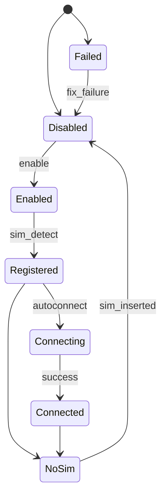

# GSM Service Documentation

## Overview

The GSM service is responsible for managing GSM modems, handling their configuration, and ensuring they connect to the network using appropriate APNs. This document provides a high-level overview (black box) and a detailed internal explanation of how the `gsm.lua` module works.

## GSM Interface Overview

### Responsibilities

- **Modem Management**: Detects and manages GSM modems.
- **Configuration Handling**: Applies configurations to modems based on their IMEI or device type.
- **Network Connection**: Attempts to connect modems to the network using ranked APNs.
- **State Monitoring**: Monitors the state of modems and handles state transitions.

### Key Functions

- **`gsm_service:start`**: Starts the GSM service and initializes the modem manager.

### Bus Interactions

- **Incoming Messages**:
  - **Modem Capability**: Subscribes to `hal/capability/modem/+` to handle modem capability messages.
  - **Modem Info**: Subscribes to various endpoints under `hal/capability/modem/<modem_index>/info/` to get state and hardware information
  - **Configuration**: Subscribes to `config/gsm` to handle configuration messages.

- **Outgoing Messages**:
  - **Modem Control**: Publishes commands to various endpoints under `hal/capability/modem/<modem_index>/control/` to navigate modem through the state machine.
  - **Network Interface**: Publishes network interface information to `gsm/modem/<modem_idx>/net-interface`.

### Configuration

- **Default Configuration**: Holds default settings for modems.
- **Known Modems**: Specific configurations for known modems identified by IMEI or device path.

Set `pdp_type` in `modems.default` or override it in a `modems.known` entry.
Accepted values are `IP`, `IPV4V6`, and `IPV6`. Modems inherit the default;
if neither specifies a type, GSM uses `IP`.

```json
{
  "schema": "devicecode.config/gsm/1",
  "modems": {
    "default": { "enabled": true, "pdp_type": "IP" },
    "known": [
      { "name": "primary", "imei": "123456789012345", "pdp_type": "IPV4V6" }
    ]
  }
}
```

Whenever an autoconnecting modem is disabled, GSM checks active PDP contexts
against its configured `pdp_type` before enabling it. A mismatch is corrected
within a service-lifetime scope consisting of the modem ID, SIM identity (or a
fallback while ICCID is unavailable), effective PDP type, and CID. The write
preserves the complete existing `CGDCONT` definition after the PDP type,
including APN and modem-specific fields.

Enforcement is bounded and monotonic for the lifetime of the GSM service:

- A scope permits two failed outer inspections. Successful inspections do not
  consume or reset this budget.
- Each CID permits two correction invocations. An invocation is consumed before
  dispatch, including a pre-dispatch rejection.
- A correction episode permits two restart reservations. Reservations are made
  before the restart RPC and are not refunded after failure or cancellation.

Verified applied corrections continue through the remaining eligible CIDs and
then share one restart episode. A correction whose result is uncertain also
requires a restart, but stops later sibling corrections. Definite rejections do
not require a restart and allow later siblings to proceed unless that CID has
exhausted its correction budget. If a second rejection follows changes already
made in the same pass, GSM services their restart episode first, then fails open
without a post-restart inspection. Normal successful restarts always require a
fresh disabled-state inspection before enable.

When a budget is exhausted, GSM emits `pdp_enforcement_exhausted` at error level
with the budget kind (`inspection`, `correction`, or `restart`), its absorption
scope, modem, affected CID or CIDs, effective type, counts and limit, and
`enable_proceeding=true`; enabling then proceeds in that disabled pass. A CID
blocked by restart exhaustion is skipped on later passes, while eligible or new
CIDs remain enforceable. Enforcement state survives modem object recreation,
configuration application, temporary SIM absence, and fallback-to-ICCID
migration, but is neither persisted to disk nor evicted during the service
process lifetime.

If no contexts are reported active, no contexts are rewritten.
Replies containing another PDP command's records or a different command echo,
and active CIDs missing from the context list, fail inspection and prevent enabling.
Successful inspections log `pdp_contexts_checked` with the requested type and each
CID's observed type/activity. PDP logs never include raw ICCID, IMSI, APN,
credentials, private SIM keys, or the preserved context-definition tail.

PDP commands are allowed in disabled or registered state; restart is allowed from
any state. Unsupported manufacturers retain their existing enable/connect behavior.
The backend prefers the secondary AT port and falls back to the primary AT port
when no secondary port is available.
Changing this setting does not immediately disconnect an already connected modem;
it is enforced the next time an autoconnecting modem is disabled. Modems with
autoconnect disabled are not reconfigured or restarted.

### Cellular generations

Within the existing `devicecode.config/gsm/1` schema, modem defaults and individual
`modems.known` entries may specify:

```json
"cellular_modes": {
  "preferred": "4g",
  "allowed": ["3g", "4g"]
}
```

Generations are `2g`, `3g`, `4g`, and `5g`. Preferred may also be `none` to request
no explicit preference. Both fields must be present after inheritance from modem
defaults. Missing fields inherit individually; an explicit allowed list replaces
the default list completely. Allowed lists must be nonempty; duplicates and order
have no significance.

GSM applies settings only when the modem advertises an exact preferred/allowed
pair. If no pair matches, GSM logs a warning and leaves the modem's current modes
unchanged. It does not add or remove allowed generations or substitute a different
preference, including `none` for a single-generation request.

Settings apply on modem discovery, configuration changes, and recovery, including
when `autoconnect` is false. Initialization, locked SIMs, and failed modem states
defer application until the modem becomes usable. Changes apply to connected
modems and may briefly interrupt connectivity. GSM skips an already-matching
setting, verifies writes by reading the modes back, and retries I/O/apply failures
after 20 seconds independently of APN retries. Invalid or unsupported requests
produce per-modem warnings without blocking normal connection management.

Omitting `cellular_modes` preserves existing behavior. Removing the effective
settings stops managing modes; it does not reset the modem to automatic selection.
Unsupported requests and application failures log the requested pair and reason.

HAL exposes `get` fields `supported_modes` (a list of combinations) and
`current_modes` (one combination), each shaped as `{preferred, allowed}`. The
`set_modes` control operation takes typed `ModemSetModesOpts(preferred, allowed)`.
The modem backend provides `read_modes()` and `set_modes(preferred, allowed)`;
generation configuration validation belongs to GSM.

## GSM Internal Overview

### Data Structures

- **`configs`**: Holds configurations for modems, indexed by IMEI or device type.
- **`modems`**: Stores active modems, indexed by preferred ID fields (IMEI or device).

### Classes and Methods

#### `Modem` Class

- **`Modem:autoconnect(ctx, cutoff)`**:
  - Gathers Modem and sim information.
  - Retrieves ranked APNs and attempts to connect using them.
  - Monitors the connection status and retries if necessary.

- **`Modem:enable_autoconnect(ctx)`**:
  - Spawns a fiber to monitor modem state changes.
  - Handles state transitions such as `failed`, `no_sim`, `disabled`, `registered`, and `connected`.

- **`Modem:update_config(config)`**:
  - Updates the modem configuration and enables/disables autoconnect based on the configuration.

- **`new_modem(ctx, bus_conn, imei, index, modemcard)`**:
  - Creates a new modem instance and initializes its context, bus connection, IMEI, index, and modem card.

#### `gsm_service` Table

- **`gsm_service:start(service_ctx, bus_connection)`**:
  - Starts the GSM service by spawning a fiber for the GSM manager.
  - The GSM manager handles modem capability detection and configuration updates.

### Event Handling

- **`modem_capability_handler(ctx, bus_conn, modem_capability_msg)`**:
  - Handles modem capability messages, subscribes to modem information topics, and updates the modem configuration.

- **`config_handler(config_msg)`**:
  - Handles configuration messages, updates the default and known modem configurations, and applies them to active modems.

### GSM Manager

- **`gsm_manager(ctx, bus_conn)`**:
  - Subscribes to modem capability and configuration topics.
  - Processes capability and configuration messages in a loop, updating modem states and configurations as needed.

### Modem State Transitions


